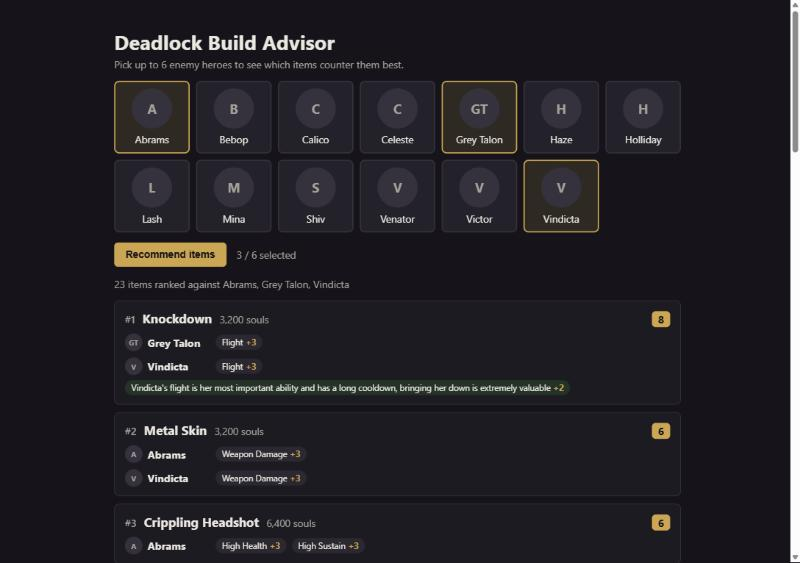
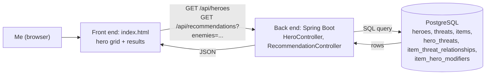

# Deadlock Build Advisor

A web app for me, a newer Deadlock player, that ranks which items counter the enemy heroes I'm facing and explains why each one helps.

**Author:** Johan Santana · **Course:** CMP 464/343 Product 1

## Demo

Picking Abrams, Grey Talon and Vindicta as enemies. Knockdown ranks first: both Grey Talon and Vindicta fly (+3 each), and a matchup modifier adds +2 because Vindicta's flight is her most important ability.



## 1. About Me (the User)

I'm the player. Deadlock is the first MOBA game that I've played, so there are many things that are new and confusing to me, despite Deadlock looking somewhat similar to games I've played before.

**The last 3 times this happened:**

1. I laned against a Victor (high sustain hero) and lost that lane because he had too much effective HP.
2. I lost a game because the enemy Celeste was able to generate a substantial soul lead, because she always managed to escape.
3. I laned against a Venator and lost that lane because he was pumping out too much damage, and I was never able to approach him without losing a lot of health.

**What it costs me:**

- ⏱️ **Time:** A Deadlock match lasts around 30–35 minutes on average, so if I'm investing that much time into a match, I want to win.
- 🙂 **Joy:** It upsets me when I look back on a match I lost and realize there were items I could have bought earlier, or items I could have bought at all, that may have saved the game.

## 2. Problem Statement

> **When** I am losing a lane or struggling against specific enemies in Deadlock,
> **I struggle to** determine which items would best counter the problems I am experiencing,
> **which costs me** the opportunity to respond effectively during a match and can contribute to losing games after around 35 minutes of play.
> **This happens because** deciding which item to buy requires considering my hero, enemy heroes, their abilities, my current situation, and other factors at the same time.
> **Right now, I** either look through the shop myself or follow a general build from the community builder system, **but** neither approach specifically evaluates what counter item is most relevant to the situation currently occurring in my match.

**I'll know this is solved when:** I select the enemy heroes I am facing, and I can quickly identify several relevant counter items and understand why each one could help in my situation.

## 3. Existing Solutions

| What I use or tried | What it does well | Why it falls short *for me* |
|---|---|---|
| Looking through the shop myself for counters | Gives me access to all of the available items and lets me manually look for something that might solve my problem. | I have to remember what items do and manually connect their effects to the enemies and situation. That's hard to do quickly, since you need to buy fast during a match. |
| Following a build from the in-game community builder | Provides an established build path and shows which items are generally recommended for my hero. | A general/meta build doesn't account for the specific enemies or problems I'm facing. It tells me what is generally good, not what responds to my current situation. |
| Searching for counter information outside the game | Can teach me which items or strategies work against particular heroes. | It takes extra time and still requires me to work out how the information applies to my hero, the other enemies, and my specific problem. |

**The gap:** quickly seeing **which counter items are relevant to the current match and why**, rather than a general build.

## 4. Features & Benefits

| Feature | Benefit | MVP or Later? |
|---|---|---|
| Pick up to 6 enemy heroes from a hero grid, with a short description of each hero on hover | Tells the system which enemies I need to respond to, in a few clicks. | MVP (built) |
| A ranked list of counter items, with the reasons for each item grouped by enemy hero | Actionable options without manually comparing every item in the shop, and it teaches me *why* an item counters a hero. | MVP (built) |
| Each item's cost, with the cheaper item ranked first when two items tie | Helps me pick a counter I can afford sooner. | MVP (built) |
| Matchup modifiers: hero-specific exceptions to the general rules | Recommendations reflect real game knowledge, not just broad categories. | MVP (built) |
| Enter my own hero | Items that fit my hero's build rank higher. | Later |
| Select the main problem I'm experiencing | Describe what's going wrong instead of relying only on enemy heroes. | Later |
| Enter my current items and souls | Skip items I already own and show what's affordable now. | Later |
| Live match tracking | Dynamically update the recommended items based on the match state | Later |

### MVP

- Pick the enemy heroes I'm facing (up to 6).
- Get a ranked list of counter items with the reason each one helps, grouped by enemy hero.
- See each item's cost, with the cheaper item first on a tie.

### Later

- Enter my own hero, so items that fit my build rank higher (the `item_hero_synergies` table already exists)
- Select the main problem I'm having in the match
- Enter my current items and souls, to skip owned items and show what's affordable
- Heroes with more than one common build (e.g. weapon vs spirit Drifter)
- Every hero and item in the game (the MVP covers 13 heroes and 23 items)
- Deploy it online, and eventually an in-game overlay

### Not doing

- Machine learning or AI-generated recommendations. The scores are hand-written rules, so every recommendation can be explained.
- A full build planner or community build platform. Deadlock already has one in-game.
- User accounts or saved builds.

## 5. Tech Stack

### Front end

- **Surface:** Web
- **Tools:** One HTML page (`src/main/resources/static/index.html`) with plain CSS and JavaScript, no framework
- **Why:** I play Deadlock on my PC, so a browser tab I can alt-tab to, or keep on a second monitor, fits where I have the problem. The page only needs a hero grid and a results list, so a framework would add setup without adding anything I need yet.

### Back end

| Piece | Choice | Why |
|---|---|---|
| Server / API | Java 21 + Spring Boot (REST controllers, `JdbcTemplate`) | Java is the language I know best, and Spring Boot gives me a web server, JSON conversion and a database connection with little setup. I write plain SQL through `JdbcTemplate` because the scoring is one SQL query with joins. |
| Data storage | PostgreSQL | The data is naturally relational: heroes have threats, items counter threats, and junction tables link them. SQL joins and `SUM` do the scoring in the database. |
| Outside services | None | All hero, item and threat data is entered by me in `db/seed.sql`. |
| Hosting / deploy | Runs locally for now | Deploying also needs a hosted PostgreSQL database. It's on the Later list, so the demo uses screenshots. |

### Architecture



1. When the page loads, it calls `GET /api/heroes` and draws one card per hero.
2. When I pick enemies and click **Recommend items**, it calls `GET /api/recommendations?enemies=Grey Talon,Vindicta`.
3. `RecommendationController` runs the scoring query in PostgreSQL, groups the rows by item, and returns JSON.
4. The page draws one card per item, with its score and reasons.

## How the Scoring Works

The recommendation engine is a rule-based scoring system. Items are not scored against heroes directly. Instead, each enemy hero is described by the **threats** they bring, and each item is scored by how well it **answers** those threats.

### Threats

A threat is a problem an enemy can create:

| Threat | Meaning |
|---|---|
| High Sustain | Self healing, shielding or external healing |
| Weapon Damage / Spirit Damage | Steady weapon or spirit damage |
| Weapon Burst / Spirit Burst | A high burst of weapon or spirit damage |
| High Mobility | Hard to catch or escape from |
| Soft Crowd Control | Slows, silences and other limits that still let you walk |
| Hard Crowd Control | Stuns and displacements |
| Flight | Can fly or hover in the air |
| Lingering Debuffs | Effects that stay on you for a set time and tick or weaken you |
| Stacking Burst | Stacks build up, then pop for burst damage |
| High Health | High effective HP from resists, base HP or HP scaling |

A threat is defined by **what counters it**. For example, Lingering Debuffs and Stacking Burst are separate because Debuff Reducer helps against lingering effects but not against stacks.

Each enemy hero is linked to the threats they bring **with their most common build** (`hero_threats`). For example, Holliday is listed for Spirit Damage, not Weapon Damage, because she is usually built for spirit.

### Effectiveness

Each item is linked to the threats it counters, with an effectiveness score and a reason (`item_threat_relationships`):

| Score | Meaning |
|---|---|
| 1 | Helps a little |
| 2 | Solid answer |
| 3 | Core counter |

Only items that actually address a threat get a row. No row means the item does not help against that threat.

The scores follow a few consistent rules:

- **Passive resists** (Bullet Vest, Metal Skin, Plated Armor, Spirit Resilience) score high against **steady** damage and low against **burst**.
- **Shields** (Weapon Shielding, Spirit Shielding) score high against **burst** and low against **steady** damage.
- **Upgraded items score higher** than the items they are built from.

### Matchup modifiers

Threats are general rules, and some heroes are exceptions. A matchup modifier (`item_hero_modifiers`) adds or removes points for one item against one hero, from −3 to +3, with a reason:

| Item | Hero | Modifier | Why |
|---|---|---|---|
| Plated Armor | Abrams | −2 | Most of Abrams' weapon damage is melee, so plated armor does little against him |
| Knockdown | Vindicta | +2 | Flight is Vindicta's most important ability and has a long cooldown |
| Slowing Hex | Holliday | −1 | It doesn't stop her from using a jump pad that's already placed |

Rule of thumb: if the same interaction applies to several heroes, it's a **threat**. If it applies to one hero's specific ability, it's a **modifier**.

### Calculating a score

For a given enemy team:

1. Find every threat each enemy hero brings.
2. Find every item that counters each of those threats.
3. Add up the effectiveness for each item. If two enemies bring the same threat, the item counts for both, so items that answer several enemies rank higher.
4. Add any matchup modifiers for those enemies.
5. Drop items with a score of 0 or less, then sort by score, highest first. Ties go to the cheaper item.

The query lives in [`RecommendationController.java`](src/main/java/com/johan/deadlock_build_advisor/recommendation/RecommendationController.java). A version you can run directly in pgAdmin is in [`db/queries/recommend_items.sql`](db/queries/recommend_items.sql).

### Example

Enemy team: **Grey Talon** (Flight, Spirit Burst, Soft Crowd Control) and **Vindicta** (Flight, Weapon Damage).

| Item | Score | Why |
|---|---|---|
| Knockdown | 8 | Flight 3 (Grey Talon) + Flight 3 (Vindicta) + Vindicta modifier 2 |
| Phantom Strike | 6 | Flight 3 (Grey Talon) + Flight 3 (Vindicta) |
| Slowing Hex | 4 | Flight 2 (Grey Talon) + Flight 2 (Vindicta) |

Both enemies fly, so anti-flight items take the top spots, and Knockdown pulls ahead because of the Vindicta modifier.

The score represents how relevant an item is in the given matchup, not one objectively correct purchase.

### Not used in scoring yet

The schema already has tables for these, but the score doesn't use them yet:

- **Hero synergy** (`item_hero_synergies`): how well an item fits the player's own hero, from 1 to 3.
- **Upgrade chains** (`item_components`): which items an upgrade is built from.

## Project Structure

```
db/
  schema.sql                  Creates the tables
  seed.sql                    Fills them with heroes, items, threats and their relationships
  queries/recommend_items.sql The scoring query, for running in pgAdmin
src/main/java/com/johan/deadlock_build_advisor/
  hero/                       GET /api/heroes
  recommendation/             GET /api/recommendations
src/main/resources/
  application.properties      Database connection settings, read from .env
  static/index.html           The front end
```

## Running Locally

Requirements: Java 21 and PostgreSQL.

1. Create a database, then run `db/schema.sql` and then `db/seed.sql` in it (e.g. in pgAdmin's Query Tool).
2. Copy `.env.example` to `.env` and fill in your database URL, username and password. `.env` is gitignored, so your password never ends up in the repo.
3. Start the app:
   ```bash
   ./mvnw spring-boot:run
   ```
4. Open http://localhost:8080.
