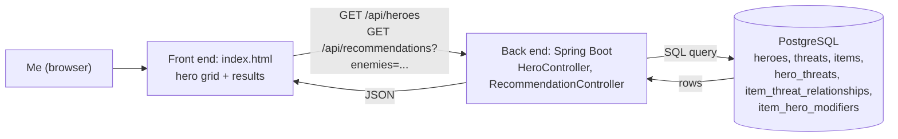

# Product 1 Spec Template

# Deadlock Counter-Building Advisor

> A web app for me, a newer Deadlock player, that ranks which items counter the enemy heroes I'm facing and explains why each one helps.
> 

**Author:** Johan Santana · **Course:** CMP 464/343 Product 1 · **Last updated:** 11/01/26

---

## 1. About Me (the User)

*Who am I in the context of this problem? What roles am I playing (student, employee, parent, athlete, gamer…)?*

I’m the player, Deadlock is the first MOBA game that I’ve played so there are many things that are new and confusing to me despite Deadlock looking somewhat similar to games I’ve played before.

**The last 3 times this happened:** *Real, recent moments. For each: when and where, what went wrong, what it cost, what you did.*

1. I laned against a victor (high sustain hero) and lost that lane because he had too much effective HP.
2. I lost a game because the enemy Celeste was able to generate a substantial soul lead due to the fact that she always managed to escape.
3. I laned against a Venator and lost that lane because he was pumping out too much damage and I was never able to approach him without losing a lot of health.

**What it costs me:** *Be specific. How often, how much?*

- ⏱️ Time: A deadlock match lasts around 30-35 minutes on average, so if I’m investing that much time into a match I want to win.
- 🙂 Joy: It upsets me a little when I look back on a match that I lost and realize that there were items I could have bought earlier, or items that I could have just bought in general that may have saved the game.

---

## 2. Problem Statement

**Gut check:**

> I need a counter-builder because I struggle to buy the right items that address the current situation.
> 

**Five Whys:**

1. **Why?** 
I struggle to buy the right items
2. **Why?** 
Because the usefulness of an item is dependent on many different factors and it's hard to evaluate what to buy.
3. **Why?** 
It’s hard to evaluate because there are many things you have to weigh in a short amount of time.
4. **Why?** 
The player must do this manually while the game is ongoing because the existing game info and general build recommendations do not translate into a personalized situation specific next purchase decision.
5. **Why?**
There is no decision support process that connects the relevant match factors and explains how they should influence the player's next purchase.

**Problem statement:**

> **When** I am losing a lane or struggling against specific enemies in Deadlock,
**I struggle to** determine which items would best counter the problems I am experiencing,
**which costs me** the opportunity to respond effectively during a match and can contribute to losing games after around 35 minutes of play.
**This happens because** deciding which item to buy requires considering my hero, enemy heroes, their abilities, my current situation, and other factors at the same time.
**Right now, I** either look through the shop myself or follow a general build from the community builder system, **but** neither approach specifically evaluates what counter item is most relevant to the situation currently occurring in my match.
> 

**I’ll know this is solved when:** 

When I select the enemy heroes I am facing, I can quickly identify several relevant counter items and understand why each one could help in my situation.

---

## 3. Existing Solutions

| What I use or tried | What it does well | Why it falls short *for me* |
| --- | --- | --- |
| Looking through the shop myself for counters | Gives me access to all of the available items and lets me manually look for something that might solve my problem. | I have to remember what items do and manually connect their effects to the enemies and situation. This can be difficult to evaluate in a time crunch, as you need to buy quickly during the match. |
| Following the build path from a build in the community builder system | Provides an established build path and helps me know what items are generally recommended for my hero. | A general/meta build does not necessarily account for the specific enemies or problems I am facing. It tells me what is generally good, rather than what is relevant as a response to my current situation. A community build doesn’t necessarily account for the specific enemies or problems I am facing |
| Searching for information about specific counters outside the game | Can help me learn what items or strategies may work against particular heroes. | It takes additional time and still requires me to interpret how the information applies to my own hero, the other enemies, and the specific problem I am experiencing. |

**The gap:**

The ability to quickly assess the situation and identify **which counter items are relevant to the current match and why**, rather than simply receiving a general build.

---

## 4. Features & Benefits

*Every feature should move me toward my “solved when” line.*

| Feature (what it does) | Benefit (how my life gets better) | MVP or Later? |
| --- | --- | --- |
| Pick up to 6 enemy heroes from a hero grid, with a short description of each hero on hover | Lets the system know which enemies I need to respond to, in a few clicks. | MVP (built) |
| Receive a ranked list of counter items, with the reasons for each item grouped by enemy hero | Gives me actionable options without requiring me to manually compare every item in the shop, and teaches me *why* an item counters a hero. | MVP (built) |
| Show each item's cost, and rank the cheaper item first when two items tie | Helps me pick a counter I can actually afford sooner. | MVP (built) |
| Matchup modifiers: hero-specific exceptions to the general rules (e.g. Plated Armor is weaker against Abrams because his damage is mostly melee) | Recommendations reflect real game knowledge, not just broad categories. | MVP (built) |
| Enter my own hero | Items that fit my hero's build rank higher (the `item_hero_synergies` table already exists). | Later |
| Select the main problem I am experiencing, such as getting kited or struggling against sustain | Lets me describe what is going wrong instead of relying only on enemy heroes. | Later |
| Enter my current items and available souls | Skips items I already own and shows which ones I can afford right now. | Later |
| Support heroes with more than one common build (e.g. weapon vs spirit Drifter) | Threats match how that enemy is actually built in my game. | Later |
| In-game overlay | Get recommendations without leaving the game. | Later |

## **MVP (2–3 features):** *The skateboard: the smallest version I’d actually use.*

- Pick the enemy heroes I'm facing (up to 6).
- Get a ranked list of counter items with the reason each one helps, grouped by enemy hero.
- See each item's cost, with the cheaper item first on a tie.

## **Later:**

- Enter my own hero, so items that fit my build rank higher
- Select the main problem I'm having in the match
- Enter my current items and souls, to skip owned items and show what's affordable
- Heroes with more than one common build
- Every hero and item in the game (the MVP covers 13 heroes and 23 items)
- Deploy it online, and eventually an in-game overlay

## **Not doing:** *Things I’m deliberately leaving out.*

- Live game tracking or automatic detection of heroes and items. Deadlock has no public API for live matches.
- Machine learning or AI-generated recommendations. The scores are hand-written rules, so every recommendation can be explained.
- A full build planner or community build platform. Deadlock already has one in-game.
- User accounts or saved builds.

---

## 5. Tech Stack

### Front end

- **Surface:** Web
- **Tools:** One HTML page with plain CSS and JavaScript (no framework), served by Spring Boot
- **Why:** I play Deadlock on my PC, so a browser tab I can alt-tab to (or keep on a second monitor) fits where I have the problem. The page only needs a hero grid and a results list, so a framework would add setup without adding anything I need yet.

### Back end

| Piece | Choice | Why |
| --- | --- | --- |
| Server / API | Java 21 + Spring Boot (REST controllers, `JdbcTemplate`) | Java is the language I know best, and Spring Boot gives me a web server, JSON conversion and database connection with little setup. I use plain SQL through `JdbcTemplate` because the scoring is a SQL query with joins. |
| Data storage | PostgreSQL | The data is naturally relational: heroes have threats, items counter threats, and junction tables link them. SQL joins and `SUM` do the scoring directly in the database. |
| Outside services (optional) | None | All hero, item and threat data is entered by me in `db/seed.sql`. |
| Hosting / deploy | Runs locally for now; demo shown with screenshots | Deploying needs a hosted PostgreSQL database too. That's on the Later list. |

### Architecture sketch

---

## 6. Open Questions

*What am I still unsure about? What do I need to figure out or test first?*

- Are my effectiveness numbers (1–3) and modifiers right? They are my own judgement and need testing in real matches.
- How should heroes with more than one common build be handled?
- Deadlock is updated often. How do I keep item and hero data current after patches?
- Where to deploy the app and its database so anyone can open a live link.