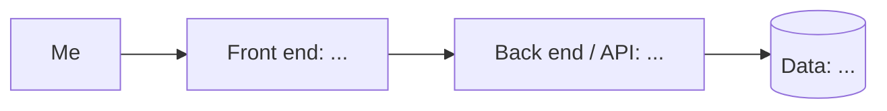

# Product 1 Spec Template

# Deadlock Counter-Building Advisor

> One line: what this is and who it’s for (hint: it’s for you).
> 

**Author:** Johan Santana· **Course:** CMP 464/343 Product 1 · **Last updated:** 10/05/26

---

## 1. About Me (the User)

*Who am I in the context of this problem? What roles am I playing (student, employee, parent, athlete, gamer…)?*

I’m the player, Deadlock is the first MOBA game that I’ve played so there are many things that are new and confusing to me despite Deadlock looking somewhat similar to games I’ve played before.

**The last 3 times this happened:** *Real, recent moments. For each: when and where, what went wrong, what it cost, what you did.*

1. I laned against a victor (high sustain hero) and lost that lane because he had too much effective HP.
2. I lost a game because the enemy Celeste was able to generate a substantial soul lead due to the fact that she always managed to escape.
3. I laned against a Venator and lost that lane because he was pumping out too much damage and I was never able to approach him without losing a lot of health.

**What it costs me:** *Be specific. How often, how much?*

- ⏱️ Time: A deadlock match lasts around 30-35 minutes on average, so if I’m investing that much time into a match I want to win.
- 🙂 Joy: It upsets me a little when I look back on a match that I lost and realize that there were items I could have bought earlier, or items that I could have just bought in general that may have saved the game.

---

## 2. Problem Statement

**Gut check:**

> I need a counter-builder because I struggle to buy the right items that address the current situation.
> 

**Five Whys:**

1. **Why?** 
I struggle to buy the right items
2. **Why?** 
Because the usefulness of an item is dependent on many different factors and it's hard to evaluate what to buy.
3. **Why?** 
It’s hard to evaluate because there are many things you have to weigh in a short amount of time.
4. **Why?** 
The player must do this manually while the game is ongoing because the existing game info and general build recommendations do not translate into a personalized situation specific next purchase decision.
5. **Why?**
There is no decision support process that connects the relevant match factors and explains how they should influence the player's next purchase.

**Problem statement:**

> **When** I am losing a lane or struggling against specific enemies in Deadlock,
**I struggle to** determine which items would best counter the problems I am experiencing,
**which costs me** the opportunity to respond effectively during a match and can contribute to losing games after around 35 minutes of play.
**This happens because** deciding which item to buy requires considering my hero, enemy heroes, their abilities, my current situation, and other factors at the same time.
**Right now, I** either look through the shop myself or follow a general build from the community builder system, **but** neither approach specifically evaluates what counter item is most relevant to the situation currently occurring in my match.
> 

**I’ll know this is solved when:** 

When I enter my hero, the relevant enemy heroes, and the main problem I am experiencing, I can quickly identify several relevant counter items and understand why each one could help in my situation.

---

## 3. Existing Solutions

| What I use or tried | What it does well | Why it falls short *for me* |
| --- | --- | --- |
| Looking through the shop myself for counters | Gives me access to all of the available items and lets me manually look for something that might solve my problem. | I have to remember what items do and manually connect their effects to the enemies and situation. This can be difficult to evaluate in a time crunch, as you need to buy quickly during the match. |
| Following the build path from a build in the community builder system | Provides an established build path and helps me know what items are generally recommended for my hero. | A general/meta build does not necessarily account for the specific enemies or problems I am facing. It tells me what is generally good, rather than what is relevant as a response to my current situation. A community build doesn’t necessarily account for the specific enemies or problems I am facing |
| Searching for information about specific counters outside the game | Can help me learn what items or strategies may work against particular heroes. | It takes additional time and still requires me to interpret how the information applies to my own hero, the other enemies, and the specific problem I am experiencing. |

**The gap:**

The ability to quickly assess the situation and identify **which counter items are relevant to the current match and why**, rather than simply receiving a general build.

---

## 4. Features & Benefits

*Every feature should move me toward my “solved when” line.*

| Feature (what it does) | Benefit (how my life gets better) | MVP or Later? |
| --- | --- | --- |
| Enter my hero and the enemy heroes I am facing | Lets the system understand who I am playing and which enemies I need to respond to. | MVP |
| Select the main problem/threat I am experiencing, such as getting kited, taking too much damage, or struggling against enemy sustain | Lets me describe what is actually going wrong in the match instead of relying solely on enemy hero information. | MVP |
| Receive a ranked list of relevant counter items with an explanation of why each item is relevant | Gives me actionable options without requiring me to manually compare every item in the shop. | MVP |
| Show relevant items recommendations with item cost and relevant tradeoffs | Helps me determine which recommended counter is practical for my current amount of gold and situation. | MVP |

## **MVP (2–3 features):** *The skateboard: the smallest version I’d actually use.*

- 

## **Later:**

## **Not doing:** *Things I’m deliberately leaving out.*

---

## 5. Tech Stack

### Front end

- **Surface:** [CLI / Web / Mobile / Cross-platform / Chat]
- **Tools:** [e.g., Next.js, Python, Expo]
- **Why:** *How does this fit where and when I have the problem?*

### Back end

| Piece | Choice | Why |
| --- | --- | --- |
| Server / API |  |  |
| Data storage |  |  |
| Outside services (optional) |  |  |
| Hosting / deploy |  |  |

### Architecture sketch

---

## 6. Open Questions

*What am I still unsure about? What do I need to figure out or test first?*

-